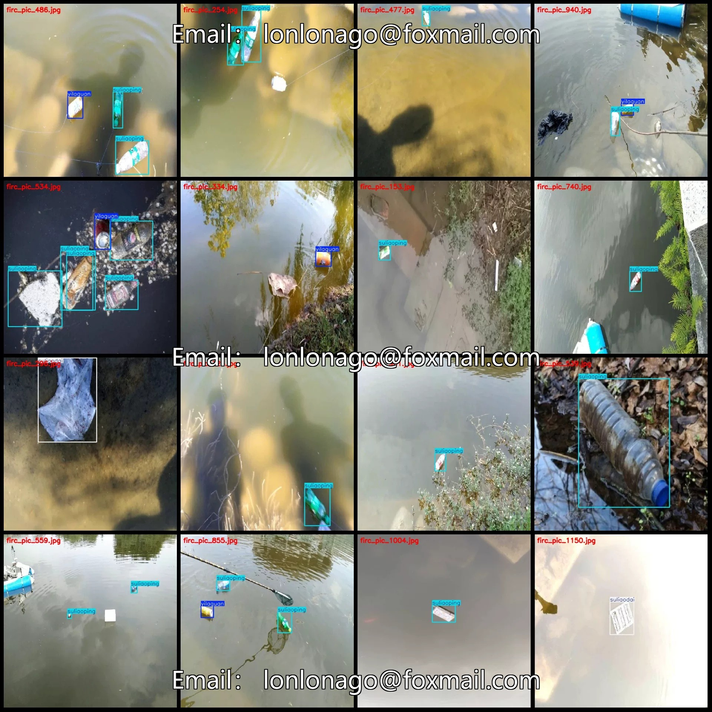
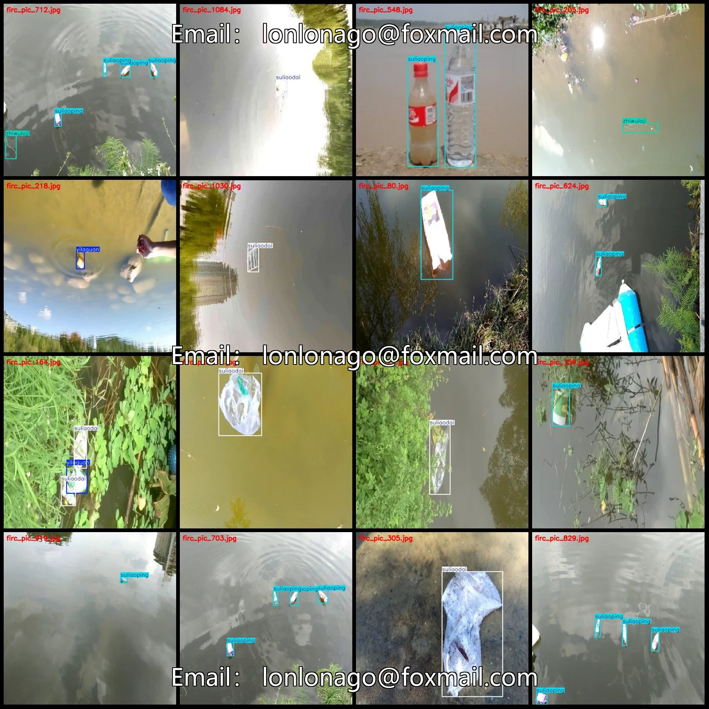
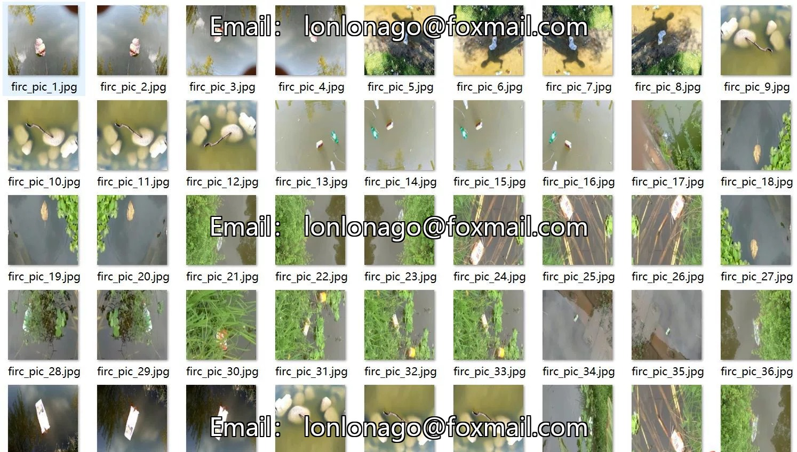
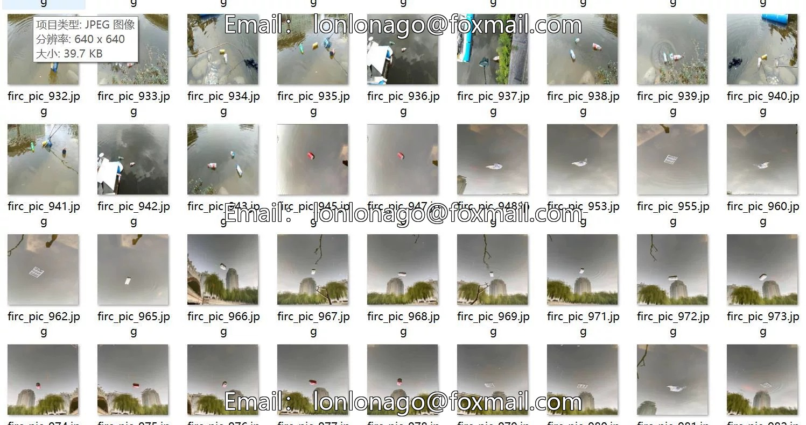
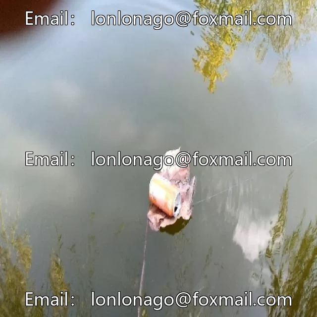
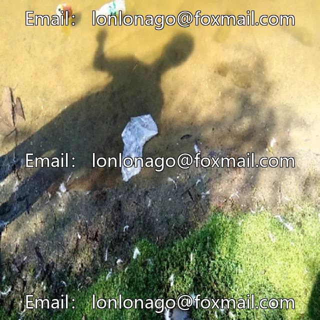
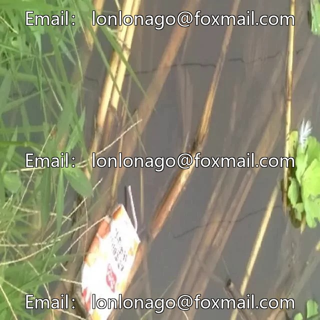

# Riverbed Garbage Detection Dataset VOC+YOLO format: 1259 images in 4 categories

## Body

Waterway Garbage Detection Dataset VOC+YOLO format with 1259 images in 4 categories
Tips: Due to the dataset's replicability, please confirm compliance before purchasing.
Dataset format: Pascal VOC format + YOLO format (txt file without split paths, only containing jpg images and corresponding VOC format xml files and yolo format txt files)
Number of images (number of jpg files): 1259
Number of annotations (number of xml files): 1259
Number of annotations (number of txt files): 1259
Number of annotation categories: 4

Annotation categories (Note that the order of labels in YOLO format does not correspond to this, but is based on the classes.txt file in the labels folder): ["suliaodai", "suliaoping", "yilaguan", "zhiwulaji"]
The number of bounding boxes and images per category:
- suliaodai (plastic bags) = 328 bounding boxes, 317 images
- suliaoping (plastic bottles) = 1355 bounding boxes, 776 images
- yilaguan (aluminum cans) = 487 bounding boxes, 451 images
- zhiwulaji (vegetable waste) = 59 bounding boxes, 52 images

Total number of frames: 2229
Image resolution: 640x640
Labeling tool used: labelImg
Labeling rules: Draw a rectangle around the category.
Important note: The dataset does not include splits for training, validation, or test sets; you must create your own.
Special statement: This dataset does not guarantee the accuracy of the trained models or weight files.

## Images

## Payment

Here is a pay link on Stripe ( https://buy.stripe.com/3cs8yP7sY87d0vu9AB ). Please contact me lonlonago@foxmail.com after funding $89, and I will send you a complete data files , thank you!

